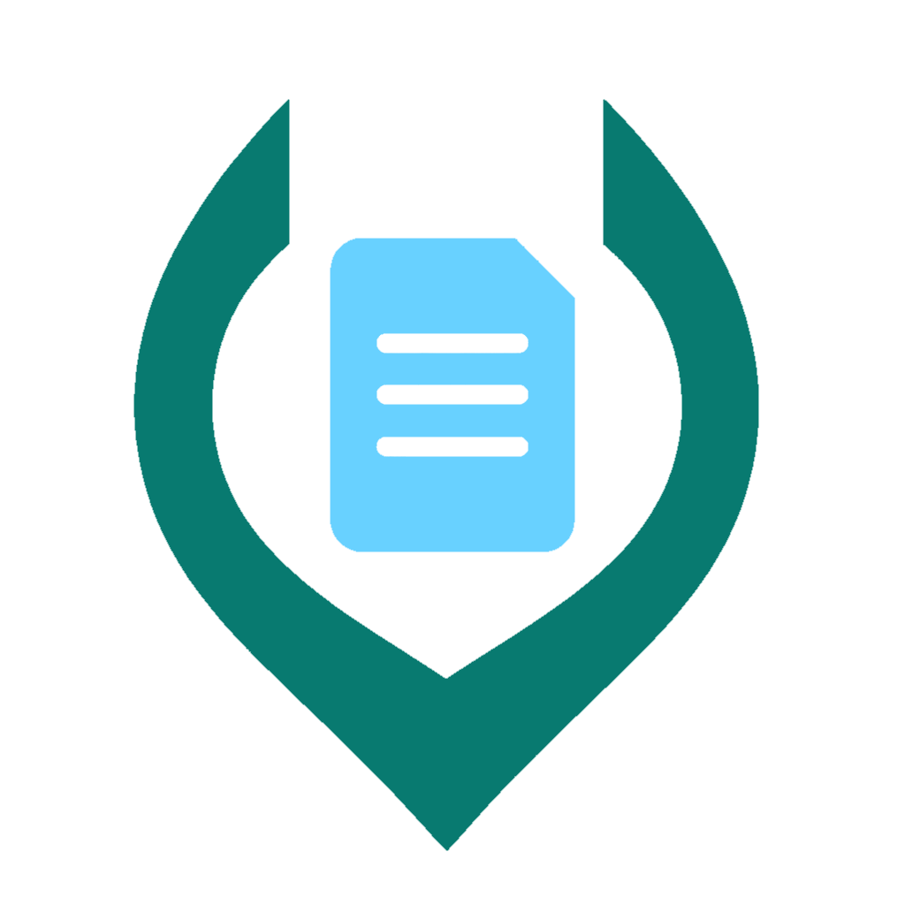

<p align="center">
  
</p>

<h1 align="center">
  
</h1>

Convert **PDF, Office documents and images to JSON, Markdown or HTML** using a web UI, HTTP API, command line or .NET library. Office documents and HTML are converted through Gotenberg, included in both Docker Compose stacks.

## Features

- Extract native PDF text and tables; recognize scanned content and embedded images.
- Read PNG, JPEG, WebP, BMP, single-frame GIF and ICO directly, without PDF conversion.
- Choose an OpenAI-compatible vision API or local RapidOCR / Nemotron recognition.
- Optionally enable local layout analysis for columns, table detection and image segmentation.
- Process files, public URLs or Base64 sources; use background jobs for long conversions.
- Download one document or a ZIP archive for a batch.

## Quick start

Requires Docker with Linux containers and **Docker Compose 2.24+**. Run from the repository root.

1. Copy the [environment template](.env.example) to [.env](.env):

   ```sh
   cp .env.example .env
   ```

   On Windows cmd, use `copy .env.example .env` instead.

2. Choose recognition settings in the copied file:

   | Provider | Configuration | Requirements |
   | --- | --- | --- |
   | OpenAI-compatible API (default) | FLEXYPARSE_RECOGNITION_PROVIDER=OpenAi | Set FLEXYPARSE_MODEL_API_KEY; adjust API URL/model as needed. |
   | RapidOCR | FLEXYPARSE_RECOGNITION_PROVIDER=RapidOcr | Local CPU OCR; no API key. Default language profile: eslav. |
   | Nemotron CPU | FLEXYPARSE_RECOGNITION_PROVIDER=NemotronCPU | Local INT8 model; about 761 MB download and several GB of RAM. |
   | Nemotron GPU | Use the GPU stack below | Local FP16 model; about 1.45 GB download and several GB of RAM/VRAM. |

3. Start the standard stack:

   ```sh
   docker compose --env-file .env -f docker/docker-compose.image.yml up --build -d
   ```

Open **<http://localhost:8080>**. Interactive API documentation: <http://localhost:8080/docs>.
The standard stack does not expose a GPU. First use of a local provider downloads and verifies its models; follow startup progress in the logs.

To work without recognition, turn it off in the UI or explicitly send **do_ocr=false** in API requests. This still extracts native PDF text/tables and processes Markdown.

### GPU stack: Linux Intel/AMD

Requires a compatible Vulkan driver and an accessible Linux DRM render node. Set the group ID for your GPU, then start the **standalone** [GPU Compose stack](docker/docker-compose.image.gpu.yml):

```sh
export FLEXYPARSE_GPU_RENDER_GID=$(stat -c '%g' /dev/dri/renderD128)
docker compose --env-file .env -f docker/docker-compose.image.gpu.yml up --build -d
```

This starts **FlexyParse with NemotronGPU and Gotenberg**, preserves the same model cache, and grants the non-root application access to the GPU. Stop the standard stack before switching; do not run both on the same ports.

This recipe is **not** for NVIDIA or Docker Desktop GPU passthrough. Nemotron uses WebGPU, not CUDA; other deployments need platform-specific device/driver setup. There is no automatic fallback to CPU or an external provider. See [deployment and GPU requirements](docs/host.md#gpu-deployment).

### Logs and shutdown

```sh
docker compose --env-file .env -f docker/docker-compose.image.yml logs -f flexyparse gotenberg
docker compose --env-file .env -f docker/docker-compose.image.yml down
```

For GPU, add the same file selection used at startup. Shutdown preserves downloaded models; adding **-v** deletes the model volume. Gotenberg is exposed only on host loopback at port 3000; FlexyParse uses its internal service address.

### Run a published image (no local build)

The [GitHub Actions workflow](.github/workflows/docker.yml) tests the solution and builds standard and GPU Linux x64 images. After the workflow has published to GHCR, use the [standard image stack](docker/docker-compose.yml):

```sh
docker compose --env-file .env -f docker/docker-compose.yml pull
docker compose --env-file .env -f docker/docker-compose.yml up -d
```

For Linux Intel/AMD GPU, set the render-node group as above and select [the GPU image stack](docker/docker-compose.gpu.yml) instead. Both include Gotenberg and the same persistent model cache, with no build context or source compilation. Use the same file for logs and shutdown.

Images are **ghcr.io/ambyte/flexyparse:latest** and **ghcr.io/ambyte/flexyparse:latest-gpu**. Set FLEXYPARSE_IMAGE_TAG in the environment file to a published version such as **1.2.3** (the GPU stack appends **-gpu** automatically). CI builds and publishes only when a new **v*** tag is pushed and its commit belongs to **main** history. Each accepted tag updates latest; semantic version tags such as **v1.2.3** also publish **1.2.3**, **1.2** and their GPU counterparts. Every publication has a **sha-<short-commit>** tag, with **-gpu** for GPU. Ordinary branch pushes and pull requests do not trigger CI; manual dispatch is disabled. See [CI and registry setup](docs/host.md#github-actions-and-ghcr) for permissions, visibility and tag validation.

All Dockerfiles and Compose files are under [docker](docker). The root [.dockerignore](.dockerignore) remains at the repository build-context root so local secrets, artifacts and models stay excluded.

## Local .NET and CLI

Requires **.NET SDK 10**. Direct .NET startup reads process environment/configuration, not the local environment file.

```sh
dotnet run --project src/FlexyParse.Host --no-launch-profile -- serve --urls http://localhost:8080
dotnet run --project src/FlexyParse.Host -- convert report.pdf --format markdown --output report.md --recognize-images false
```

For Office/HTML support outside Docker, configure an accessible Gotenberg URL. See [Host usage](docs/host.md).

## HTTP API example

```sh
curl -f http://localhost:8080/v1/convert/file -F "files=@report.pdf" -F "to_formats=md" -F "do_ocr=false" -o result.json
```

One document returns a JSON wrapper containing the requested content; multiple documents return ZIP. The JSON document model is FlexyParse's own schema, not DoclingDocument. See [API requests, responses and background jobs](docs/api.md).

## Configuration and limitations

- Start with **MAIN SETTINGS** in the [environment template](.env.example); provider tuning, limits, background jobs and debugging are grouped separately. See the [Host guide](docs/host.md#configuration) for deployment details.
- Models are cached in a persistent Docker volume and verified before reuse. A verified local cache works offline.
- RapidOCR produces plain text; Nemotron produces structured Markdown. Recognition quality depends on source resolution and model quality; dense, low-resolution pages can contain errors or trigger repetition protection.
- Optional layout analysis is heuristic, assumes left-to-right column flow and does not guarantee exact table/layout reconstruction.
- Multi-frame images are rejected. Default decoded-image limits are 16,384 pixels per dimension and 40 million pixels.
- Before public deployment, configure an incoming API key, TLS and appropriate resource limits. Background tasks are process-local and do not survive a restart.

## Project and development

| Component | Responsibility |
| --- | --- |
| [Core](src/FlexyParse.Core) | Conversion pipeline, extraction, layout analysis and output writers. |
| [Host](src/FlexyParse.Host) | Web UI, API, background jobs and CLI. |
| [RapidOCR provider](src/FlexyParse.Recognition.RapidOcr) | Local CPU OCR and model provisioning. |
| [Nemotron provider](src/FlexyParse.Recognition.Nemotron) | Local CPU INT8 / WebGPU FP16 recognition. |
| [Tests](tests) | Conversion, HTTP, provider, deployment and browser regression tests. |

```sh
dotnet build FlexyParse.slnx -c Release
dotnet test FlexyParse.slnx -c Release
node --test tests/docker-compose.test.cjs tests/web-ui.test.cjs
```

Compose regression tests require the Docker Compose CLI, but do not start containers. They use isolated temporary settings and cover both present and missing optional environment files through resolved configuration, without requiring environment-file metadata in Compose output; your local settings are not read or modified. Tests and CI do not depend on personal startup scripts. Native model/GPU and real-browser checks are optional and need their respective runtimes.

## License

FlexyParse is licensed under the [MIT License](LICENSE). Third-party libraries, services and model weights retain their own licenses.

Further reading: [Host and deployment](docs/host.md) · [HTTP API](docs/api.md) · [.NET library and architecture](docs/core.md).
